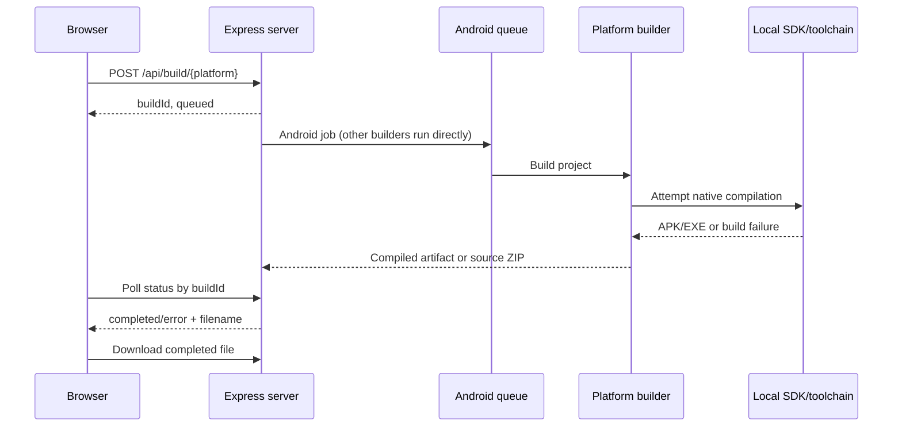
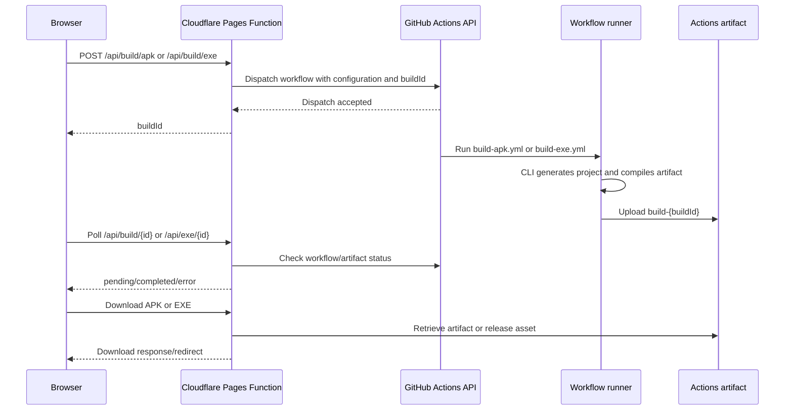

# How SiteToApp Works

SiteToApp has a static Astro frontend and two separate build paths. Locally, the browser talks to the Express server and local platform tools. On the deployed Cloudflare Pages site, Android and Windows build requests are delegated to GitHub Actions.

## Local flow

The Astro pages provide the forms and previews. The Android client submits its URL, identity, icon, and WebView options to `/api/build/apk`; the Windows client submits engine, installer, window, and user-agent choices to `/api/build/exe`. Express normalizes URLs without a scheme and limits build requests to 10 per IP per 15 minutes.

Android builds pass through `queue-manager.js`: it uses BullMQ/Redis if Redis is available when the server starts, or an in-memory queue otherwise. The builder writes the generated project under `builds/{buildId}/android/`, fetches or generates icons, and attempts compilation with JDK 17, Gradle 8.12, and the Android SDK. Windows, macOS, and Linux builders generate Electron projects; Tauri is an alternative Windows wrapper. Compilation depends on the operating system and installed toolchain. A builder may return a source ZIP when it cannot produce a native package.

The Express server keeps status metadata in memory. A restart loses the mapping from build IDs to files. There is no configured cleanup for generated build directories. Batch builds also have a limitation: their per-platform IDs are not registered as pending before completion, so polling early can return 404.

## Cloudflare Pages and GitHub Actions flow

The Cloudflare Functions are in `functions/api/`. Android dispatches `.github/workflows/build-apk.yml`; Windows dispatches `build-exe.yml`. Both workflows run their CLI entry point on a hosted runner and upload an artifact named `build-{buildId}`. The Windows workflow also publishes the EXE as a draft GitHub release asset; its download function prefers a signed asset redirect and can fall back to the Actions artifact.

The Android Pages status function checks for the matching artifact, then uses recent Android workflow runs as a fallback. That fallback is not associated with a specific build ID, so concurrent builds or a failed run can make status ambiguous or leave a request pending. The Windows function uses a build-tagged draft release when visible and checks the build-specific artifact on successful workflow completion.

The Pages build functions require `GITHUB_PAT` and currently target the `bluewizardz/webtoapp` repository on `main`. The deployment workflow requires `CLOUDFLARE_API_TOKEN` and `CLOUDFLARE_ACCOUNT_ID`. `PUBLIC_BACKEND_URL` can configure the frontend API base at build time; otherwise, frontend requests use the current origin. See [SETUP.md](SETUP.md) for deployment configuration.

## Local GitHub Actions behavior

Running `npm start` does not call GitHub Actions. It builds the site, starts Express, and invokes local builders. GitHub Actions are used for the deployed Pages flow, and generated source projects may also include workflows for users who choose to build those projects in their own repositories.

## Favicon flow

The builder previews call `/api/favicon`. Locally this is an Express proxy that fetches a favicon and uses Sharp to convert it where possible. On Cloudflare Pages, `functions/api/favicon.js` performs the proxying, applies an eight-second timeout, limits HTML inspection, and rejects several private/local host patterns. The two implementations are similar in purpose but are not identical in validation behavior.

## Output expectations

The local Android builder can mark its result completed even when compilation fell back to a source ZIP; inspect the filename before assuming it is an APK. The GitHub CLI build scripts exit unsuccessfully on source-ZIP fallback, and their workflows require an APK or EXE file before uploading. The deployed download functions therefore expect compiled artifacts.
